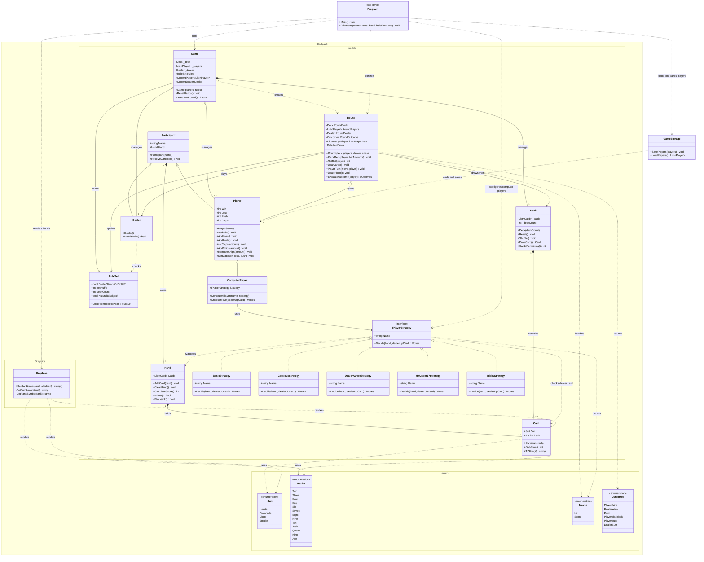

# Blackjack - Konsolspel

Detta är ett Blackjack spel som startas med dotnet run i terminalen. Spelet stödjer upp till 5 spelare (människor och datorstyrda bottar) och körs direkt i konsolen. Spelet är uppbyggt av flera klasser: Participant är basklass för Player, Dealer och ComputerPlayer. Hand beräknar poäng och hanterar Ess. Deck skapar och blandar kortleken. Round styr omgångar och insatser, medan Game håller ihop spelsessionen. RuleSet läser inställningar från rules.txt och GameStorage sparar statistik i players.txt. Graphics och ConsoleUi hanterar kortgrafik och användargränssnitt.

Alla fyra tillval har byggts i projektet:

Kortgrafik: Graphics.cs ritar kort bredvid varandra med ramar, Unicode-symboler och dolda hålkort. ConsoleUi hanterar röda och vita färger. (Ramez Khurshid)

Bettingsystem: Marker sparas i players.txt. (Rameel Siddiqui)

Datorstyrda spelare: Bottar styrs via IPlayerStrategy med 5 olika strategier. (Rojvan Qasim)

Konfigurationsfil: RuleSet.cs läser regler från rules.txt med fail-safe om filen saknas. (Talha Malik)

Reglerna följer klassisk Blackjack. Kända brister är om en enskild rad saknas i rules.txt används defaultvärdet utan att användaren varnas om vilken specifik rad som fattades.

# Klass diagram i mermaid

The diagram includes the main properties, methods, and relationships in the project.

`Program` represents the top-level statements in `ConsoleUi.cs`.
